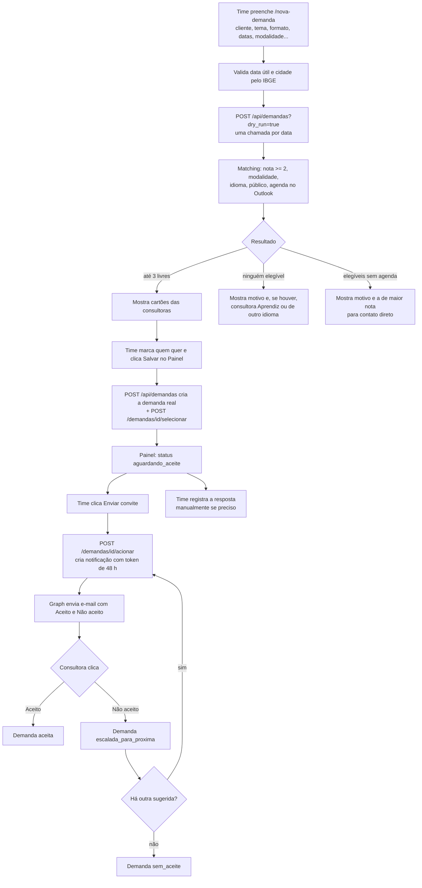
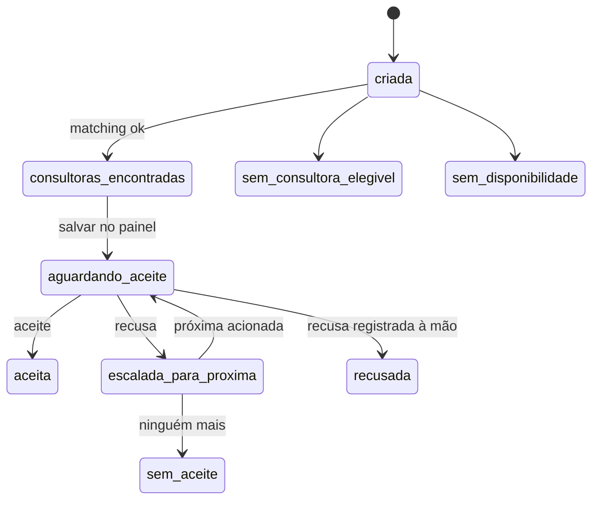
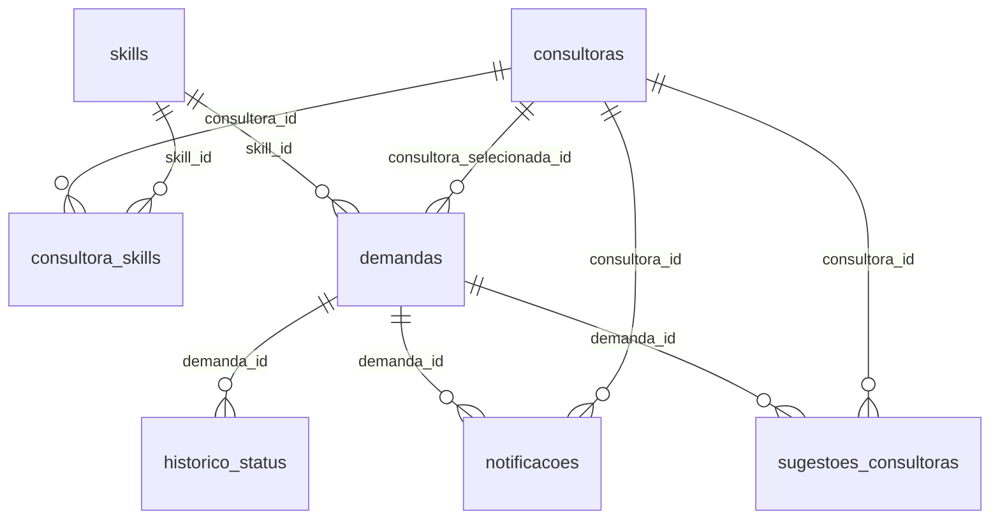

# Buscador C&D — documentação para recriar o sistema do zero

Repositório: `tecnologiact/buscador-ced` · Levantamento em 21/10/2026 a partir do código (último commit de 16/09/2026).

> **Para quem é este documento.** Para uma pessoa de desenvolvimento que nunca viu o sistema. Explica o problema de negócio, o banco (inclusive as colunas que o código usa e o `schema.sql` não traz), o algoritmo de escolha de consultoras, a integração com o Outlook, o fluxo de aceite por e-mail e as telas. No fim há um roteiro de recriação e um checklist.

---

## 1. O que o sistema faz

### 1.1 O problema

A área de **Carreira e Desenvolvimento (C&D)** da Cia de Talentos entrega workshops, masterclasses, mentorias e outros formatos para empresas clientes. Quem conduz cada entrega é uma **consultora** (facilitadora) de uma equipe com mais de 20 pessoas, cada uma com domínio diferente dos **61 temas** do portfólio (comunicação, liderança, inteligência emocional etc.).

Antes do sistema, escolher quem conduz era manual: o time lia uma planilha de competências, abria a agenda de cada pessoa uma a uma, mandava mensagem e esperava resposta em texto livre, sem registro. Isso gerava demora, esquecimentos e nenhuma rastreabilidade.

O **Buscador C&D** faz isso em minutos:

1. O time informa a **demanda**: cliente, tema, formato, data(s), modalidade, idioma, público e cidade.
2. O sistema cruza o tema com a **nota de cada consultora**, filtra por modalidade, idioma e público, consulta a **agenda do Outlook** delas e propõe **até 3 consultoras livres**, das mais experientes para as menos.
3. O time escolhe quem acionar. O sistema salva a demanda num **painel**, envia um **e-mail com botões "Aceito" e "Não aceito"** e registra a resposta. Se a primeira recusa, o sistema aciona a próxima da lista.

### 1.2 Glossário

| Termo | Significado |
|---|---|
| **Consultora** | Facilitadora da equipe C&D que conduz entregas (cadastro com e-mail da empresa) |
| **Skill / tema / temática** | Um dos temas do portfólio, por exemplo "Comunicação e Feedback". Os nomes aparecem no formulário |
| **Nota (0 a 3)** | Domínio da consultora num tema: **0** Não possuo, **1** Aprendiz (fez 1 vez), **2** Praticante (fez algumas vezes), **3** Mestre (faz de forma recorrente) |
| **Heatmap** | Planilha tema × consultora com as notas (origem dos dados) |
| **Demanda** | Pedido de entrega feito pelo time para um cliente |
| **Formato** | Tipo da entrega, com duração padrão (seção 6.1) |
| **Sugestão** | Consultora proposta pelo sistema para uma demanda (até 3, em ordem) |
| **Notificação / acionamento** | E-mail enviado à consultora, com link pessoal de resposta |
| **Dry run** | Consulta que só simula a busca, sem gravar nada |
| **Slot livre** | Intervalo da agenda sem compromissos, grande o bastante para a duração |
| **Painel** | Tela de acompanhamento das demandas salvas |

### 1.3 Quem usa

| Perfil | Como usa |
|---|---|
| **Time C&D** | `/nova-demanda` para buscar e salvar; `/painel` para convidar, registrar respostas manualmente e acompanhar |
| **Consultora** | Recebe o e-mail e clica no link; não tem login |

---

## 2. Fluxos

### 2.1 Do pedido ao aceite



### 2.2 Estados da demanda



Os status `concluida` e `cancelada` existem no `CHECK` e no painel, mas nenhum código do sistema os grava: seriam definidos à mão no banco.

---

## 3. Arquitetura e stack

| Camada | Escolha |
|---|---|
| API | **Node.js + Express 4 + TypeScript**, validação com **zod**, `tsx` em desenvolvimento |
| Banco | **Supabase (Postgres)** pelo cliente `@supabase/supabase-js` com a **chave de serviço** |
| Agenda e e-mail | **Microsoft Graph** (`@microsoft/microsoft-graph-client` + `@azure/identity`), permissões de **aplicativo** |
| Front | **HTML + JS puro** (sem framework): `nova-demanda.html` e `painel.html` |
| Carga inicial | Script Python `import_excel.py` (`openpyxl`, `supabase`) |
| Hospedagem | **Vercel**: o Express roda como função e as duas páginas são estáticas |

### 3.1 Arquivos

```text
buscador-ced/
├── schema.sql                     tabelas, índices, views e triggers (ver 5.1 para as colunas que faltam)
├── import_excel.py                importa consultoras, temas e notas da planilha
├── nova-demanda.html              formulário de busca (individual e em volume por CSV)
├── painel.html                    acompanhamento das demandas
├── gerar-resumo.js                gera um .docx de resumo de entregas (utilitário; não faz parte do produto)
├── arquitetura-mvp-alocacao-consultoras.md   proposta original (Fastify + Prisma; ver nota)
├── vercel.json                    roteia /api/* ao Express e / às páginas
├── .env.example
└── backend/
    ├── package.json, tsconfig.json
    └── src/
        ├── index.ts               servidor Express, CORS, rotas, health check
        ├── lib/{supabase,graph}.ts
        ├── routes/{demandas,notificacoes,skills,consultoras}.ts
        └── services/{matching,calendar,email}.ts
```

> O documento `arquitetura-mvp-alocacao-consultoras.md` descreve a proposta inicial (Fastify, Prisma, Teams). **A implementação usa Express e o cliente Supabase.** Use-o apenas como histórico.

### 3.2 Deploy (`vercel.json`)

```json
{
  "version": 2,
  "builds": [
    { "src": "backend/src/index.ts", "use": "@vercel/node" },
    { "src": "*.html", "use": "@vercel/static" }
  ],
  "routes": [
    { "src": "/api/(.*)", "dest": "backend/src/index.ts" },
    { "src": "/", "dest": "/nova-demanda.html" },
    { "src": "/painel", "dest": "/painel.html" },
    { "src": "/nova-demanda", "dest": "/nova-demanda.html" }
  ]
}
```

`index.ts` exporta o `app` do Express (para a Vercel) e só chama `app.listen` quando `VERCEL` não está definida.

---

## 4. Variáveis de ambiente

| Variável | Para quê |
|---|---|
| `SUPABASE_URL`, `SUPABASE_SERVICE_KEY` | Banco (chave de **serviço**, só no servidor) |
| `SUPABASE_ANON_KEY`, `DATABASE_URL` | Constam no exemplo; o código atual não as usa |
| `SP_TENANT_ID`, `SP_CLIENT_ID`, `SP_CLIENT_SECRET` | Aplicativo do Azure AD para o Graph |
| `EMAIL_FROM` | Caixa remetente dos acionamentos. Também é passada como "organizador" na consulta de agenda (no código atual não influencia o resultado) |
| `APP_BASE_URL` | Base dos links de resposta no e-mail. Padrão `https://buscador-ced.vercel.app` |
| `RESPONSE_TOKEN_TTL_HOURS` | Validade do link de resposta em horas. Padrão **48** |
| `RESPONSE_TOKEN_SECRET`, `NOTIFICATION_CHANNEL`, `TEAMS_WEBHOOK_URL`, `GRAPH_SCOPE` | No exemplo; **não são usadas** pelo código atual |
| `ALLOWED_ORIGINS` | Lista de origens do CORS separada por vírgula. Sem ela, aceita qualquer origem |
| `PORT` | Porta local (padrão 3000) |
| `EXCEL_PATH` | Planilha usada pelo `import_excel.py` |

**Permissões do Azure AD (tipo Aplicativo, com consentimento de administrador):** `Calendars.Read` (ler a agenda de qualquer consultora) e `Mail.Send` (enviar e-mail em nome de `EMAIL_FROM`). Recomenda-se restringir `Mail.Send` à caixa remetente por política de acesso do Exchange.

---

## 5. Banco de dados

### 5.1 O que o `schema.sql` cria

Rode o arquivo no editor SQL do Supabase. Ele cria 7 tabelas, índices, 2 views e triggers.

```sql
-- =============================================================
-- BUSCADOR C&D — Schema Supabase / PostgreSQL
-- Cia de Talentos | MVP Carreira & Desenvolvimento
-- =============================================================
-- Como usar:
--   1. Acesse seu projeto no Supabase → SQL Editor
--   2. Cole este arquivo inteiro e execute (Run All)
--   3. Após execução, rode o script import_excel.py
-- =============================================================

-- Extensão para UUID automático
CREATE EXTENSION IF NOT EXISTS "pgcrypto";


-- -------------------------------------------------------------
-- TABELA: consultoras
-- -------------------------------------------------------------
CREATE TABLE IF NOT EXISTS consultoras (
    id              UUID PRIMARY KEY DEFAULT gen_random_uuid(),
    nome            TEXT NOT NULL,
    email           TEXT NOT NULL UNIQUE,
    ativo           BOOLEAN NOT NULL DEFAULT TRUE,
    cidade          TEXT,
    -- Formatos que a consultora pode conduzir
    -- Ex: 'Masterclass,Workshop,Mentoria,Role-play,Devolutiva'
    formatos        TEXT,
    -- Modalidade preferencial: 'Online', 'Presencial', 'Híbrido'
    modalidade      TEXT,
    -- Disponibilidade para viagens: 'Não', 'Sim, nacional', 'Sim, internacional'
    disponibilidade_viagem TEXT,
    -- Anos de experiência como texto livre da planilha
    anos_experiencia TEXT,
    -- Públicos que atende: ex. 'Estagiário,Trainee,Primeira liderança'
    publicos        TEXT,
    -- Setores atendidos
    setores         TEXT,
    -- Certificações
    certificacoes   TEXT,
    -- Diferencial / Bio
    diferencial     TEXT,
    -- Observações adicionais
    observacoes     TEXT,
    criado_em       TIMESTAMPTZ NOT NULL DEFAULT NOW(),
    atualizado_em   TIMESTAMPTZ NOT NULL DEFAULT NOW()
);

COMMENT ON TABLE consultoras IS 'Cadastro das consultoras/facilitadoras da área C&D';
COMMENT ON COLUMN consultoras.formatos IS 'Formatos de entrega separados por vírgula';
COMMENT ON COLUMN consultoras.publicos IS 'Públicos-alvo separados por vírgula';


-- -------------------------------------------------------------
-- TABELA: skills
-- -------------------------------------------------------------
CREATE TABLE IF NOT EXISTS skills (
    id          UUID PRIMARY KEY DEFAULT gen_random_uuid(),
    nome        TEXT NOT NULL UNIQUE,
    -- Pilar do portfólio: 'Power Skills', 'Human + Machine', etc.
    categoria   TEXT,
    -- Origem do tema: 'Jovem', '1ª Liderança', 'Ambos'
    origem      TEXT,
    -- Trilha a que pertence
    trilha      TEXT,
    ativo       BOOLEAN NOT NULL DEFAULT TRUE,
    criado_em   TIMESTAMPTZ NOT NULL DEFAULT NOW(),
    atualizado_em TIMESTAMPTZ NOT NULL DEFAULT NOW()
);

COMMENT ON TABLE skills IS 'Catálogo de temas/skills do portfólio C&D (61 temas mapeados)';


-- -------------------------------------------------------------
-- TABELA: consultora_skills
-- Heatmap consultoras × temas com notas 0-3
-- -------------------------------------------------------------
CREATE TABLE IF NOT EXISTS consultora_skills (
    id              UUID PRIMARY KEY DEFAULT gen_random_uuid(),
    consultora_id   UUID NOT NULL REFERENCES consultoras(id) ON DELETE CASCADE,
    skill_id        UUID NOT NULL REFERENCES skills(id) ON DELETE CASCADE,
    -- Nota numérica: 0=Não possuo, 1=Aprendiz, 2=Praticante, 3=Mestre
    nota            SMALLINT NOT NULL CHECK (nota BETWEEN 0 AND 3),
    -- Texto original da planilha para rastreabilidade
    nivel_texto     TEXT,
    observacoes     TEXT,
    atualizado_em   TIMESTAMPTZ NOT NULL DEFAULT NOW(),
    UNIQUE (consultora_id, skill_id)
);

COMMENT ON TABLE consultora_skills IS 'Heatmap de notas por consultora × skill (0=Não possuo, 1=Aprendiz, 2=Praticante, 3=Mestre)';
COMMENT ON COLUMN consultora_skills.nota IS 'Apenas notas 2 e 3 tornam a consultora elegível para matching';


-- -------------------------------------------------------------
-- TABELA: demandas
-- -------------------------------------------------------------
CREATE TABLE IF NOT EXISTS demandas (
    id                      UUID PRIMARY KEY DEFAULT gen_random_uuid(),
    cliente                 TEXT NOT NULL,
    skill_id                UUID REFERENCES skills(id),
    -- Nome da skill no momento da criação (desnormalizado para histórico)
    skill_nome              TEXT,
    formato                 TEXT NOT NULL,
    data_entrega            DATE NOT NULL,
    hora_inicio             TIME NOT NULL,
    hora_fim                TIME NOT NULL,
    duracao_minutos         INTEGER NOT NULL CHECK (duracao_minutos > 0),
    -- 'online', 'presencial', 'hibrido'
    modalidade              TEXT NOT NULL,
    observacoes             TEXT,
    -- Status da demanda (ver domínio abaixo)
    status                  TEXT NOT NULL DEFAULT 'criada',
    -- Consultora que aceitou (preenchido após aceite)
    consultora_selecionada_id UUID REFERENCES consultoras(id),
    -- Usuário que criou (email)
    criado_por              TEXT,
    criado_em               TIMESTAMPTZ NOT NULL DEFAULT NOW(),
    atualizado_em           TIMESTAMPTZ NOT NULL DEFAULT NOW(),

    CONSTRAINT status_valido CHECK (status IN (
        'criada',
        'consultoras_encontradas',
        'aguardando_aceite',
        'aceita',
        'recusada',
        'escalada_para_proxima',
        'sem_consultora_elegivel',
        'sem_disponibilidade',
        'sem_aceite',
        'cancelada',
        'concluida'
    ))
);

COMMENT ON TABLE demandas IS 'Demandas de entrega criadas pelo time C&D para clientes';
COMMENT ON COLUMN demandas.status IS 'criada → consultoras_encontradas → aguardando_aceite → aceita/sem_aceite';


-- -------------------------------------------------------------
-- TABELA: sugestoes_consultoras
-- Consultoras sugeridas pelo matching para cada demanda
-- -------------------------------------------------------------
CREATE TABLE IF NOT EXISTS sugestoes_consultoras (
    id              UUID PRIMARY KEY DEFAULT gen_random_uuid(),
    demanda_id      UUID NOT NULL REFERENCES demandas(id) ON DELETE CASCADE,
    consultora_id   UUID NOT NULL REFERENCES consultoras(id),
    -- Nota da skill no momento do matching (snapshot)
    nota            SMALLINT NOT NULL,
    -- Slots livres encontrados pela Graph API (JSON)
    -- Ex: [{"inicio": "14:00", "fim": "18:00"}]
    slots_disponiveis JSONB,
    -- Posição na lista (1=primeira acionada, 2=segunda, etc.)
    ordem_sugerida  SMALLINT NOT NULL,
    -- Status desta sugestão específica
    status          TEXT NOT NULL DEFAULT 'sugerida',
    -- Motivo de não elegibilidade, se aplicável
    motivo          TEXT,
    criado_em       TIMESTAMPTZ NOT NULL DEFAULT NOW(),
    atualizado_em   TIMESTAMPTZ NOT NULL DEFAULT NOW(),

    UNIQUE (demanda_id, consultora_id),
    CONSTRAINT status_sugestao_valido CHECK (status IN (
        'sugerida',
        'acionada',
        'aceita',
        'recusada',
        'expirada',
        'substituida'
    ))
);

COMMENT ON TABLE sugestoes_consultoras IS 'Consultoras sugeridas pelo matching para uma demanda (até 3)';


-- -------------------------------------------------------------
-- TABELA: notificacoes
-- Registro de cada acionamento enviado à consultora
-- -------------------------------------------------------------
CREATE TABLE IF NOT EXISTS notificacoes (
    id                  UUID PRIMARY KEY DEFAULT gen_random_uuid(),
    demanda_id          UUID NOT NULL REFERENCES demandas(id) ON DELETE CASCADE,
    consultora_id       UUID NOT NULL REFERENCES consultoras(id),
    -- Canal: 'email' ou 'teams'
    canal               TEXT NOT NULL DEFAULT 'email',
    -- Status do envio/resposta
    status              TEXT NOT NULL DEFAULT 'pendente',
    enviado_em          TIMESTAMPTZ,
    respondido_em       TIMESTAMPTZ,
    -- 'aceita', 'recusada', 'aceita_com_observacao'
    resposta            TEXT,
    -- Observação da consultora (quando aceita_com_observacao)
    observacao_consultora TEXT,
    -- Token único para link de resposta por e-mail (sem autenticação pesada no MVP)
    token_resposta      TEXT UNIQUE DEFAULT encode(gen_random_bytes(32), 'hex'),
    -- ID da mensagem no canal externo (para rastreio)
    external_message_id TEXT,
    -- Quando o token expira (default: 48h após envio)
    token_expira_em     TIMESTAMPTZ,
    criado_em           TIMESTAMPTZ NOT NULL DEFAULT NOW(),

    CONSTRAINT canal_valido CHECK (canal IN ('email', 'teams')),
    CONSTRAINT resposta_valida CHECK (
        resposta IS NULL OR
        resposta IN ('aceita', 'recusada', 'aceita_com_observacao')
    )
);

COMMENT ON TABLE notificacoes IS 'Acionamentos enviados às consultoras com link/botão de aceite';
COMMENT ON COLUMN notificacoes.token_resposta IS 'Token único no link de resposta — sem precisar de login no MVP';
COMMENT ON COLUMN notificacoes.token_expira_em IS 'Token expira em 48h após envio por padrão';


-- -------------------------------------------------------------
-- TABELA: historico_status
-- Auditoria de todas as mudanças de status de uma demanda
-- -------------------------------------------------------------
CREATE TABLE IF NOT EXISTS historico_status (
    id              UUID PRIMARY KEY DEFAULT gen_random_uuid(),
    demanda_id      UUID NOT NULL REFERENCES demandas(id) ON DELETE CASCADE,
    status_anterior TEXT,
    status_novo     TEXT NOT NULL,
    descricao       TEXT,
    criado_em       TIMESTAMPTZ NOT NULL DEFAULT NOW(),
    criado_por      TEXT  -- email do usuário ou 'system'
);

COMMENT ON TABLE historico_status IS 'Log de auditoria de mudanças de status das demandas';


-- =============================================================
-- ÍNDICES PARA PERFORMANCE
-- =============================================================

-- Matching: busca por skill + nota
CREATE INDEX IF NOT EXISTS idx_consultora_skills_skill_nota
    ON consultora_skills (skill_id, nota DESC);

-- Matching: busca por consultora
CREATE INDEX IF NOT EXISTS idx_consultora_skills_consultora
    ON consultora_skills (consultora_id);

-- Demandas por status (painel)
CREATE INDEX IF NOT EXISTS idx_demandas_status
    ON demandas (status);

-- Demandas por data (agenda)
CREATE INDEX IF NOT EXISTS idx_demandas_data
    ON demandas (data_entrega);

-- Sugestões por demanda (detalhe)
CREATE INDEX IF NOT EXISTS idx_sugestoes_demanda
    ON sugestoes_consultoras (demanda_id, ordem_sugerida);

-- Notificações por token (endpoint de resposta)
CREATE INDEX IF NOT EXISTS idx_notificacoes_token
    ON notificacoes (token_resposta);

-- Histórico por demanda
CREATE INDEX IF NOT EXISTS idx_historico_demanda
    ON historico_status (demanda_id, criado_em);

-- Skills ativas
CREATE INDEX IF NOT EXISTS idx_skills_ativo
    ON skills (ativo) WHERE ativo = TRUE;

-- Consultoras ativas
CREATE INDEX IF NOT EXISTS idx_consultoras_ativo
    ON consultoras (ativo) WHERE ativo = TRUE;


-- =============================================================
-- VIEWS PARA O PAINEL BRUNNO/DANI
-- =============================================================

-- View: painel principal de demandas
CREATE OR REPLACE VIEW vw_painel_demandas AS
SELECT
    d.id,
    d.cliente,
    d.skill_nome,
    d.formato,
    d.data_entrega,
    d.hora_inicio,
    d.hora_fim,
    d.duracao_minutos,
    d.modalidade,
    d.status,
    d.observacoes,
    d.criado_por,
    d.criado_em,
    -- Consultora selecionada
    cs.nome   AS consultora_selecionada,
    cs.email  AS email_selecionada,
    -- Contagem de tentativas
    (SELECT COUNT(*) FROM notificacoes n WHERE n.demanda_id = d.id) AS total_acionamentos,
    -- Tempo médio de resposta em horas
    (SELECT ROUND(AVG(EXTRACT(EPOCH FROM (n.respondido_em - n.enviado_em)) / 3600), 1)
     FROM notificacoes n
     WHERE n.demanda_id = d.id AND n.respondido_em IS NOT NULL) AS tempo_resposta_medio_horas
FROM demandas d
LEFT JOIN consultoras cs ON cs.id = d.consultora_selecionada_id
ORDER BY d.criado_em DESC;

COMMENT ON VIEW vw_painel_demandas IS 'Visão principal do painel para Brunno e Dani';


-- View: detalhe de sugestões por demanda
CREATE OR REPLACE VIEW vw_sugestoes_detalhadas AS
SELECT
    sc.demanda_id,
    sc.ordem_sugerida,
    c.nome          AS consultora,
    c.email,
    sc.nota,
    CASE sc.nota
        WHEN 3 THEN 'Mestre'
        WHEN 2 THEN 'Praticante'
        WHEN 1 THEN 'Aprendiz'
        WHEN 0 THEN 'Não possuo'
    END             AS nivel,
    sc.status       AS status_sugestao,
    sc.slots_disponiveis,
    n.status        AS status_notificacao,
    n.resposta,
    n.observacao_consultora,
    n.enviado_em,
    n.respondido_em,
    CASE
        WHEN n.respondido_em IS NOT NULL AND n.enviado_em IS NOT NULL
        THEN ROUND(EXTRACT(EPOCH FROM (n.respondido_em - n.enviado_em)) / 3600, 1)
    END             AS tempo_resposta_horas
FROM sugestoes_consultoras sc
JOIN consultoras c ON c.id = sc.consultora_id
LEFT JOIN notificacoes n ON n.demanda_id = sc.demanda_id AND n.consultora_id = sc.consultora_id
ORDER BY sc.demanda_id, sc.ordem_sugerida;

COMMENT ON VIEW vw_sugestoes_detalhadas IS 'Detalhe de todas as sugestões e respostas por demanda';


-- =============================================================
-- FUNÇÃO: registrar mudança de status (trigger)
-- =============================================================
CREATE OR REPLACE FUNCTION fn_registrar_historico_status()
RETURNS TRIGGER AS $$
BEGIN
    IF OLD.status IS DISTINCT FROM NEW.status THEN
        INSERT INTO historico_status (demanda_id, status_anterior, status_novo, criado_por)
        VALUES (NEW.id, OLD.status, NEW.status, NEW.criado_por);
    END IF;
    NEW.atualizado_em = NOW();
    RETURN NEW;
END;
$$ LANGUAGE plpgsql;

CREATE OR REPLACE TRIGGER trg_demanda_status
    BEFORE UPDATE ON demandas
    FOR EACH ROW
    EXECUTE FUNCTION fn_registrar_historico_status();

COMMENT ON FUNCTION fn_registrar_historico_status IS 'Grava automaticamente no histórico toda mudança de status de demanda';


-- =============================================================
-- FUNÇÃO: atualizar atualizado_em automaticamente
-- =============================================================
CREATE OR REPLACE FUNCTION fn_atualizar_timestamp()
RETURNS TRIGGER AS $$
BEGIN
    NEW.atualizado_em = NOW();
    RETURN NEW;
END;
$$ LANGUAGE plpgsql;

CREATE OR REPLACE TRIGGER trg_consultoras_ts
    BEFORE UPDATE ON consultoras
    FOR EACH ROW EXECUTE FUNCTION fn_atualizar_timestamp();

CREATE OR REPLACE TRIGGER trg_skills_ts
    BEFORE UPDATE ON skills
    FOR EACH ROW EXECUTE FUNCTION fn_atualizar_timestamp();

CREATE OR REPLACE TRIGGER trg_sugestoes_ts
    BEFORE UPDATE ON sugestoes_consultoras
    FOR EACH ROW EXECUTE FUNCTION fn_atualizar_timestamp();

CREATE OR REPLACE TRIGGER trg_consultora_skills_ts
    BEFORE UPDATE ON consultora_skills
    FOR EACH ROW EXECUTE FUNCTION fn_atualizar_timestamp();
```

### 5.2 Colunas e ajustes que o código usa e o `schema.sql` não traz

O código evoluiu depois do arquivo. Para o sistema funcionar, aplique também (inferido do código e do relatório `gerar-resumo.js`):

```sql
-- demandas: novos campos do formulário
ALTER TABLE demandas ADD COLUMN IF NOT EXISTS idioma       TEXT;
ALTER TABLE demandas ADD COLUMN IF NOT EXISTS publico_alvo TEXT;
ALTER TABLE demandas ADD COLUMN IF NOT EXISTS localidade   TEXT;
-- horário passou a ser opcional (a busca usa o dia todo 08:00-19:00)
ALTER TABLE demandas ALTER COLUMN hora_inicio DROP NOT NULL;
ALTER TABLE demandas ALTER COLUMN hora_fim    DROP NOT NULL;

-- consultoras: idioma e TeamScape
ALTER TABLE consultoras ADD COLUMN IF NOT EXISTS idioma    TEXT;   -- ex.: 'Português;Inglês' (separado por ;)
ALTER TABLE consultoras ADD COLUMN IF NOT EXISTS teamscape TEXT;   -- ex.: 'Aprendiz (fiz apenas 1 vez)'
```

O painel lista também o status `aceita_com_observacao` para demandas, mas a API nunca o grava (grava `aceita`) e o `CHECK` de `demandas.status` não o prevê. Verifique no banco real se há restrições adicionais.

### 5.3 Diagrama



### 5.4 Regras do banco

- `consultora_skills.nota` é de **0 a 3**, único por (consultora, skill).
- `sugestoes_consultoras.status`: `sugerida`, `acionada`, `aceita`, `recusada`, `expirada`, `substituida`; único por (demanda, consultora).
- `notificacoes.token_resposta` nasce no banco (32 bytes aleatórios em hexadecimal) e é a chave do link; `token_expira_em` é preenchido pela API. `resposta` ∈ `aceita`, `recusada`, `aceita_com_observacao`. A API usa os `status` `enviada`, `respondida` e `erro_envio`.
- O **trigger** `trg_demanda_status` grava em `historico_status` toda mudança de status de `demandas` e atualiza `atualizado_em`.
- Views: `vw_painel_demandas` (demandas + consultora selecionada + total de acionamentos + tempo médio de resposta em horas) e `vw_sugestoes_detalhadas` (sugestões + nível por extenso + resposta e tempo de resposta).

### 5.5 Carga inicial (`import_excel.py`)

1. Instale `openpyxl supabase python-dotenv`, defina `SUPABASE_URL`, `SUPABASE_SERVICE_KEY` e `EXCEL_PATH` e rode `python import_excel.py`.
2. Lê a aba **`Base`** (uma linha por consultora). Colunas esperadas: `Email`, `Nome`, `Cidade / Estado / País de residência`, `Em quais formatos você pode atuar?`, `Possui disponibilidade para viagens?`, `Há quantos anos você atua conduzindo treinamentos ou facilitação corporativa?`, `Com quais públicos você costuma trabalhar?`, `Quais setores você já atendeu?`, `Certificações que possui`, `Qual é o principal diferencial da sua atuação como consultora ou facilitadora?`. Ignora linhas sem e-mail ou nome e e-mails repetidos.
3. Lê as abas de heatmap **`Heatmap (Temas vs. Consultoras)`** e **`Heatmap (Tema 1ª Liderança)`**: cada linha é um tema (colunas Tema, Origem, Trilha) e, a partir da 4ª coluna, uma consultora (cabeçalho = nome curto). A célula numérica vira a nota; texto vira nota por `NIVEL_PARA_NOTA` ("Mestre (faço de forma recorrente)" = 3, "Praticante (fiz algumas vezes)" = 2, "Aprendiz (fiz apenas 1 vez)" = 1, "Não possuo" ou vazio = 0).
4. Liga o nome curto do heatmap ao e-mail por um dicionário manual (`NOME_HEATMAP_PARA_EMAIL`) e, se faltar, pelo primeiro nome na base. Quem não casa é ignorada com aviso.
5. Faz `upsert` (por `email`, por `nome`, e por `consultora_id,skill_id` em lotes de 200).

> O script não preenche `idioma` nem `teamscape`; esses campos foram atualizados depois (provavelmente à mão ou por outro script).

---

## 6. O algoritmo de escolha (`services/matching.ts`)

Entrada (`executarMatching`): `skillNome`, `data` (`AAAA-MM-DD`), `horaInicio`, `horaFim` (padrão **08:00 a 19:00** quando não informados), `duracaoMinutos`, `modalidade`, `idioma?`, `publicoAlvo?`.

### 6.1 Passo a passo

1. **Tema.** Busca `skills` por `nome` e `ativo = true`. Se não achar: resultado `sem_consultora_elegivel` com a mensagem de que o tema não está no catálogo.
2. **Elegíveis por nota.** `consultora_skills` do tema com `nota >= 2`, ordenadas por nota decrescente, só de consultoras `ativo = true`.
3. **Modalidade.** `online` aceita todas. `presencial` e `hibrido` **excluem** consultoras com `modalidade = 'Online'`.
4. **Idioma (filtro rígido).** `idiomaCompativel(idiomaDaConsultora, idiomaPedido)`; o idioma da consultora pode ter vários valores separados por `;` e o padrão dela é `Português`.

   | Pedido | Quem serve |
   |---|---|
   | vazio ou `Português` | todas |
   | `Inglês` | idioma contém `Inglês` ou `Bilíngue PT/EN` |
   | `Espanhol` | contém `Espanhol` ou `Bilíngue PT/ES` |
   | `Bilíngue PT/EN` | contém `Inglês` ou `Bilíngue PT/EN` |
   | `Bilíngue PT/ES` | contém `Espanhol` ou `Bilíngue PT/ES` |

5. **Público-alvo (filtro suave).** `mapearPublicoAlvo(texto)` converte o texto livre em etiquetas:

   | Se o texto contém | Etiqueta |
   |---|---|
   | "estagi" | Estagiário |
   | "trainee" | Trainee |
   | "jovem" ou "jovens" | Estagiário **e** Trainee |
   | "primeir" e "lider" | Primeira liderança |
   | ("média", "media" ou "mid") e "lider" | Média liderança |
   | "alta", "c-level", "clevel", "diret" ou "executiv" | Alta liderança / C-Level |
   | "especialista", "técnic" ou "tecnic" | Especialistas técnicos |
   | "lideranç" sem "primeir", "média" ou "alta" | as três de liderança |

   A consultora passa se o campo `publicos` dela está **vazio** (atende todos) ou contém **alguma** das etiquetas. **Se ninguém passar, o filtro é ignorado** (usa todas as elegíveis).
6. **Sem elegíveis após os filtros:**
   - se o idioma eliminou todas: resultado `sem_consultora_elegivel` com explicação e, se houver, uma **substituta** (a de maior nota livre na data, ignorando o filtro de idioma);
   - senão: resultado `sem_consultora_elegivel` ("nenhuma consultora com nota suficiente"); se existir alguma com **nota 1 (Aprendiz)**, sugere a primeira como candidata a capacitação.
7. **Agenda.** `consultarDisponibilidade` (seção 7) para todas as elegíveis em paralelo. Se o Graph falhar, todas ficam "indisponíveis" com o erro e o resultado final é `erro_graph`.
8. **Histórico.** Tenta contar entregas aceitas por consultora no mesmo tema (campo informativo `historico_entregas`). *O código consulta a coluna `resposta` em `sugestoes_consultoras`, que não existe (ela está em `notificacoes`), então a contagem sempre dá zero; o erro é capturado e ignorado.*
9. **Seleção.** Das elegíveis com agenda livre, em ordem de nota (a ordem já vem do banco), pega **até 3**. Cada uma recebe uma justificativa em texto: `Nota <nível> em "<tema>" · agenda livre: HH:MM–HH:MM, ... · idioma "X" compatível · público-alvo considerado`.
10. **Resultados possíveis** (campo `status`):

    | Status | Quando |
    |---|---|
    | `ok` | ao menos 1 disponível |
    | `sem_consultora_elegivel` | passos 1 ou 6 |
    | `sem_disponibilidade` | há elegíveis, mas nenhuma livre; sugere a de maior nota para contato direto |
    | `erro_graph` | falha ao consultar a agenda |

A resposta traz `mensagem`, `motivo_detalhado`, `elegíveis` (todas, com justificativa), `selecionadas` (até 3) e `substituto` (consultora, motivo da exclusão, motivo da sugestão).

Campos de cada consultora no resultado: `consultora_id, nome, email, nota, nivel, disponivel, slotsLivres[{inicio,fim}], motivo?, justificativa?, historico_entregas?, certificacoes?, teamscape?, idiomas?`.

---

## 7. Agenda do Outlook (`services/calendar.ts`)

Para cada e-mail, uma chamada em paralelo: `GET /users/{email}/calendarView` com `startDateTime=<data>T<horaInicio>:00-03:00`, `endDateTime=<data>T<horaFim>:00-03:00`, `$select=start,end,showAs,isCancelled,isAllDay`, `$top=100` e o cabeçalho `Prefer: outlook.timezone="America/Sao_Paulo"`. Não se usa `encodeURIComponent` no e-mail (o SDK já codifica; fazer duas vezes dá erro 404).

**Quais eventos contam como "ocupado":** os que não estão cancelados e cujo `showAs` **não** é `free` nem `workingElsewhere`. Evento de **dia inteiro** ocupa de 0 a 1440 minutos.

**Cálculo dos slots livres** (`calcularSlotsLivres`): converte cada evento em minutos desde a meia-noite (lendo `HH:MM` do horário que o Graph devolve, já em Brasília), recorta à janela [início, fim], ordena e **junta intervalos que se sobrepõem**. Percorre a janela e registra cada intervalo livre com **duração maior ou igual à pedida**, inclusive o trecho final. A consultora está disponível se houver ao menos um slot.

Falha numa consultora (por exemplo, caixa inexistente ou externa ao tenant) marca só ela como indisponível com o erro; as demais seguem.

---

## 8. A API

Base `/api`. O código não define autenticação nas rotas.

| Rota | O que faz |
|---|---|
| `POST /demandas` | Valida o corpo (zod) e, **sem** `dry_run`, grava a demanda, roda o matching e grava as sugestões. Com `?dry_run=true` só roda o matching e devolve `{status, mensagem, selecionadas, elegiveis}` |
| `POST /demandas/:id/match` | Roda o matching de novo para uma demanda existente (sem idioma nem público) |
| `POST /demandas/:id/selecionar` | `{consultora_ids[]}`: muda a demanda para `aguardando_aceite` e faz *upsert* das sugestões escolhidas como `acionada` (nota 0 e ordem 1 se a linha não existia, caso do dry run). **Não envia e-mail** |
| `POST /demandas/:id/acionar` | `{consultora_id}`: exige que ela esteja nas sugestões; cria a notificação (token e validade) e envia o e-mail |
| `POST /demandas/:id/resposta-manual` | `{consultora_id, resposta, observacao?}`: registra a resposta como se viesse do link |
| `GET /demandas?status=&data_inicio=&data_fim=` | Lista pela view do painel |
| `GET /demandas/:id` | `{demanda, sugestoes, historico}` |
| `GET /notificacoes/:id/responder?token=&resposta=&observacao=` | Página pública que a consultora acessa pelo e-mail |
| `POST /notificacoes/:id/responder` | Variante para "aceito com observação" por formulário (implementação incompleta) |
| `GET /skills`, `GET /consultoras` | Catálogos ativos |
| `GET /health` | `{status:"ok", timestamp}` |

### 8.1 Corpo de `POST /demandas` (zod)

| Campo | Regra |
|---|---|
| `cliente`, `skill`, `formato` | texto obrigatório |
| `data` | `AAAA-MM-DD` |
| `horaInicio`, `horaFim` | `HH:MM`, opcionais |
| `duracaoMinutos` | inteiro positivo |
| `modalidade` | `online`, `presencial` ou `hibrido` |
| `idioma`, `publicoAlvo`, `localidade`, `observacoes`, `numSessoes` | opcionais |
| Regra | se `presencial` ou `hibrido`, `localidade` é obrigatória |

Erro de validação: `400 {"erro":"Dados inválidos","detalhes":{...}}`.

### 8.2 Resposta de uma consultora (link do e-mail)

Validações em ordem: parâmetros (`400` página "Link inválido"); notificação por `id` + `token` (`404` "Link não encontrado"); expiração (`410` "Link expirado"); já respondida (`409` "Já respondido"). Em seguida grava `resposta`, `respondido_em` e `status = respondida` na notificação e atualiza a sugestão (`aceita` ou `recusada`).

- **Aceito:** a demanda vira `aceita` com `consultora_selecionada_id`; a página mostra cliente, tema, data e hora.
- **Recusa:** a demanda vira `escalada_para_proxima` (se estava em `aguardando_aceite`) e, **em segundo plano**, `acionarProximaConsultora` busca a próxima sugestão `sugerida` (por `ordem_sugerida`), cria a notificação e envia o e-mail, voltando a demanda a `aguardando_aceite`. Se não houver mais ninguém, a demanda vira `sem_aceite`.

As páginas de resposta são HTML simples, no estilo "Cia de Talentos | C&D".

### 8.3 O e-mail de acionamento

Assunto `[C&D] Nova solicitação de entrega — <tema> | dd/mm/aaaa`. Corpo HTML com tabela (cliente, tema, formato, data, horário ou "A definir (N min)", modalidade, público, observações) e dois botões: **✅ Aceito** (`?resposta=aceita`) e **❌ Não aceito** (`?resposta=recusada`). Aviso de que o link é pessoal e expira em 48 horas. Enviado por `POST /users/{EMAIL_FROM}/sendMail` com `saveToSentItems: false`. Se `EMAIL_FROM` não existir, a notificação é criada mas o e-mail não sai. Falha no envio marca a notificação como `erro_envio`.

---

## 9. As telas

### 9.1 `/nova-demanda`

Duas abas: **Busca individual** e **Busca em volume (CSV)**.

**Campos:** Cliente*, Temática* (lista da API `/api/skills`, com lista local de reserva de 19 temas), Formato*, Modalidade*, Idioma (Português, Inglês, Espanhol), Público-alvo (Estagiário, Trainee, Trainee Expert, Nova Liderança, Média Liderança, Alta Liderança), Localidade* (só presencial/híbrido), Número de sessões* (só Mentoring Lab, 1 a 20), Datas (uma ou várias, com chips) e Observações.

**Duração padrão por formato (minutos):**

| Formato | Minutos |
|---|---|
| Masterclass interativa (até 2h) | 120 |
| Skill Lab ou Mini Bootcamp (2h–4h) | 180 |
| Learning Sprint (4h–6h) | 300 |
| Simulation Lab (4h–8h) | 360 |
| Hackathon (6h–8h) | 420 |
| Mentoring Lab (ciclo de sessões) | 60 |
| Career Milestone (2h–4h) | 180 |
| Assessment Experience (devolutiva 1h30–2h) | 90 |

**Validações no navegador:**
- **Data:** não pode ser passado, sábado, domingo nem feriado. Os feriados são uma **lista fixa de 2026** no código: nacionais (01/01, Carnaval 16 e 17/02, Quarta de Cinzas 18/02, Sexta-feira Santa 03/04, Páscoa 05/04, Tiradentes 21/04, Dia do Trabalho 01/05, Corpus Christi 04/06, Independência 07/09, Aparecida 12/10, Finados 02/11, República 15/11, Consciência Negra 20/11, Natal 25/12) e de SP (aniversário da cidade 25/01 e 9 de Julho).
- **Localidade:** formato `Cidade – UF` (aceita `-`, `–`, `—`). Rejeita valores como "a definir", "tbd", "teste", "marte" etc., confere se a UF existe e se a cidade existe naquela UF na **API de municípios do IBGE** (`servicodados.ibge.gov.br/api/v1/localidades/municipios`, carregada ao abrir a página e comparada sem acento). Se o IBGE estiver fora do ar, deixa passar.
- Mensagens padronizadas por campo obrigatório ("O campo 'Cliente' é obrigatório." etc.).

**Busca:** uma chamada `POST /api/demandas?dry_run=true` **por data**. O resultado aparece por data, com etiquetas de idioma e localidade, os cartões das consultoras (nome, nível, slots livres, justificativa, certificações, TeamScape, idiomas, quantidade de entregas) e, quando não há ninguém, o motivo e a substituta. O usuário marca consultoras (cada marca é "consultora + data") e clica **Salvar no Painel**: para cada marca, o front faz `POST /api/demandas` (grava de verdade) seguido de `POST /api/demandas/:id/selecionar`.

**Busca em volume (CSV):** baixa um modelo com `;` como separador e BOM. Colunas: `cliente; tematica; formato; data (AAAA-MM-DD); modalidade; idioma; publico_alvo; localidade` (e opcionais `observacoes`, `duracao_minutos`). Aceita datas `AAAA-MM-DD`, `DD/MM/AAAA` e `DD-MM-AAAA`; se o arquivo vier em Windows-1252 relê com essa codificação. Cada linha passa pelas mesmas validações (modalidade válida, data útil, localidade IBGE) e roda um `dry_run`; no fim, uma tabela com os resultados e botão para salvar as linhas escolhidas.

Existe também uma função `extrairDaObservacoes(texto)` que deduz idioma e público a partir de palavras do texto livre.

### 9.2 `/painel`

Atualiza ao abrir. Lista as demandas dos status do painel: `aguardando_aceite, aceita, aceita_com_observacao, recusada, sem_aceite, concluida, cancelada` (as buscas nunca salvas ficam de fora). Filtros por status e por intervalo de datas, paginação de 10 em 10, duas abas (**Lista** e **Calendário** mensal) e um modal de detalhe com as sugestões, o status de cada uma, o histórico de status e as ações: **Enviar convite** (`acionar`), **Aceitou** e **Recusou** (`resposta-manual`). Também há ações direto na linha da tabela.

Rótulos: Aguardando resposta, Aceita, Aceita c/ obs., Recusada, Sem aceite, Concluída, Cancelada.

---

## 10. Marca e visual

Páginas simples em HTML/CSS próprio com as cores da CT (vermelho `#EE222B`, preto, azul para destaques). As páginas de resposta da consultora usam um cartão branco centralizado.

---

## 11. Como recriar do zero (roteiro)

1. **Supabase:** crie o projeto, rode `schema.sql` e os `ALTER` da seção 5.2.
2. **Azure AD:** registre o aplicativo, gere um segredo e conceda `Calendars.Read` e `Mail.Send` (Aplicativo) com consentimento. Defina a caixa `EMAIL_FROM`.
3. **Backend:** `cd backend && npm install`; variáveis da seção 4; implemente `lib/supabase`, `lib/graph`, `services/*`, `routes/*` e `index.ts` conforme as seções 6 a 8. `npm run dev` roda em `localhost:3000`.
4. **Carga:** monte a planilha (seção 5.5) e rode `import_excel.py`. Complete `idioma`, `modalidade` e `teamscape` das consultoras.
5. **Páginas:** `nova-demanda.html` e `painel.html` (seção 9). Em `localhost` o front chama `http://localhost:3000/api`; em produção, `/api`.
6. **Vercel:** `vercel.json` da seção 3.2 e as variáveis de ambiente.

### 11.1 Checklist de verificação

1. `GET /health` responde `ok`; `GET /api/skills` devolve os temas.
2. Uma busca para um tema com uma consultora nota 3 livre retorna `ok` e a coloca em primeiro.
3. Pedir inglês só devolve consultoras com "Inglês" ou "Bilíngue PT/EN" no idioma; sem ninguém, vem `sem_consultora_elegivel` com a substituta em português.
4. Pedir presencial exclui quem tem modalidade "Online".
5. Colocar um evento de dia inteiro na agenda de teste torna a consultora indisponível na data.
6. Salvar no painel cria a demanda em `aguardando_aceite`; **Enviar convite** manda o e-mail e cria a notificação.
7. Clicar **Não aceito** muda a demanda para `escalada_para_proxima`, e a segunda consultora recebe o e-mail.
8. Clicar duas vezes no mesmo link mostra "Já respondido"; depois de 48 h mostra "Link expirado".
9. `historico_status` tem uma linha por mudança de status.

---

## 12. Dados pessoais

O banco guarda nome, e-mail, cidade, formatos, públicos, setores, certificações, diferencial e observações das consultoras, e o e-mail e a resposta de cada acionamento. Não há tela de edição desses cadastros: a manutenção é por planilha e script.

---

---

*Documentação gerada pela leitura do código em 21/10/2026. Não foram executados testes nem acessados Vercel, Supabase ou Microsoft 365. O esquema real do banco em produção pode ter colunas além das listadas; confira no painel do Supabase.*
