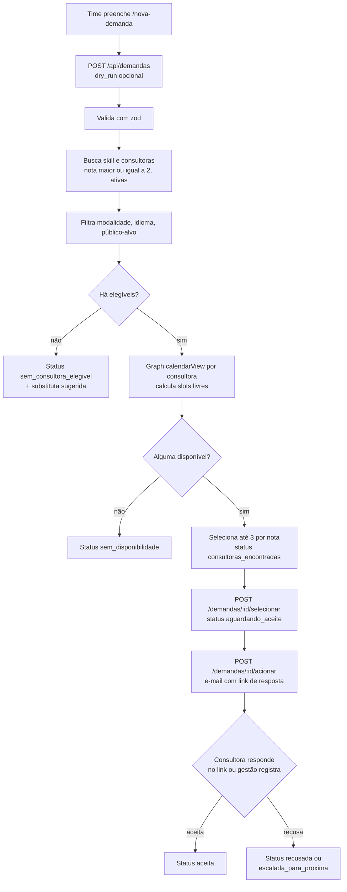

# Buscador C&D

Documentação técnica e funcional · repo `buscador-ced` (público) · último commit 16/09/2026

**Stack:** `Express 4` `TypeScript` `Supabase` `Microsoft Graph` `zod` `HTML estático`

## Funcional

Encontra consultoras para entregas de Carreira e Desenvolvimento. O time cria uma demanda (cliente, tema, formato, data, horário, modalidade, idioma e público-alvo) e o sistema sugere até 3 consultoras disponíveis. Depois o time aciona por e-mail e acompanha o aceite no painel.

- `/nova-demanda` é o formulário e `/painel` acompanha as demandas e registra respostas manuais.
- Regra de elegibilidade: nota 2 (Praticante) ou 3 (Mestre) na skill do tema, com prioridade para a nota 3.
- Filtros: modalidade (presencial e híbrido excluem consultoras só online), idioma (filtro rígido) e público-alvo (filtro suave: se ninguém bate, usa todas). Consultora sem público cadastrado atende todos.
- Sem elegível ou sem agenda livre, o sistema devolve o motivo e, quando possível, uma consultora substituta.

## Fluxo da demanda

## Técnico

| Endpoint | Função |
|---|---|
| `POST /api/demandas` | Cria a demanda e roda o matching (aceita `?dry_run=true` para só simular) |
| `POST /api/demandas/:id/match` | Reexecuta o matching |
| `POST /api/demandas/:id/selecionar` | Salva as consultoras escolhidas e muda para aguardando_aceite |
| `POST /api/demandas/:id/acionar` | Envia o e-mail de acionamento |
| `POST /api/demandas/:id/resposta-manual` | Gestão registra aceite, recusa ou aceite com observação |
| `GET /api/demandas`, `/:id` | Lista (view do painel) e detalhe com sugestões e histórico |
| `GET/POST /api/notificacoes/:id/responder` | Página pública da consultora, protegida por token com validade (48 h) |
| `GET /api/skills`, `/api/consultoras` | Catálogos para os formulários |

- Tabelas: `consultoras`, `skills`, `consultora_skills` (nota 0 a 3), `demandas`, `sugestoes_consultoras`, `notificacoes` e `historico_status`, mais as views `vw_painel_demandas` e `vw_sugestoes_detalhadas`. Um gatilho grava cada mudança de status em `historico_status`.
- Agenda: `/users/{email}/calendarView` com permissão de aplicação `Calendars.Read`, no fuso -03:00. Funciona para qualquer conta do tenant, sem depender de compartilhamento.
- Variáveis: `SUPABASE_URL`, `SUPABASE_SERVICE_KEY`, `SP_TENANT_ID`, `SP_CLIENT_ID`, `SP_CLIENT_SECRET`, `APP_BASE_URL`, `EMAIL_FROM`, `RESPONSE_TOKEN_SECRET`, `ALLOWED_ORIGINS`.
- Carga inicial da base: `import_excel.py` lê a planilha "C&D - Cadastro de Consultoras 2026-27" e preenche consultoras, skills e notas.
- Deploy: `vercel.json` serve o Express como função e as páginas `nova-demanda.html` e `painel.html` como estáticas.

---
Documentação gerada pela leitura do código em 21/10/2026. Itens marcados como não verificados precisam de confirmação do time.
